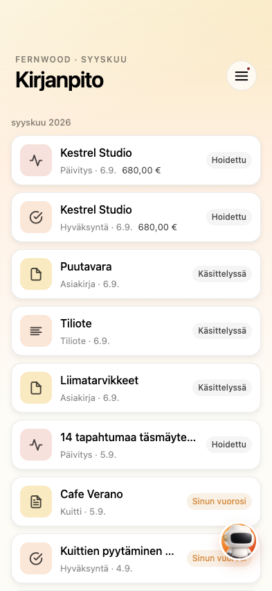
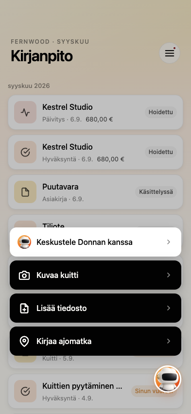
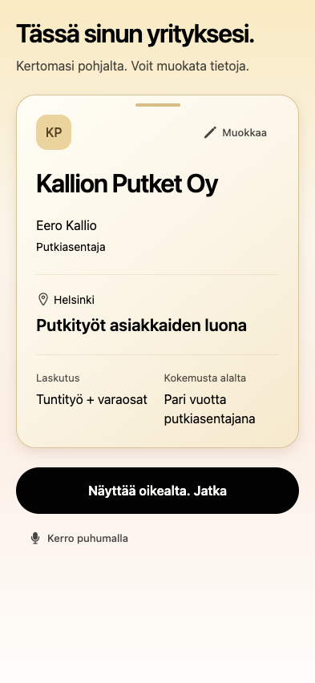

# Donna mobile

A phone app for Donna, the AI bookkeeping engine. A business owner photographs
a receipt, answers the questions only they can answer, and approves what needs
their say. Everything else is decided on the server.

This is a source release of a working prototype, not a supported product.
There is no app-store build, no hosted backend, no support and no warranty. It
was built by Kari Honkanen, much of it written with AI coding agents (Claude
and Codex). The Donna engine is released separately:
[donna-oss](https://github.com/imappi/donna-oss).

| Books | An approval | The capture menu | Onboarding |
| --- | --- | --- | --- |
|  |  |  |  |

The screenshots show invented demo data in Finnish; English is also built in.

## Status

- **It runs end to end against the bundled mock server** (`mockserver/`): sign
  in, onboarding, the Books stream, answering and approving, receipt and file
  capture, chat, mileage and settings, on invented demo books.
- **It is not connected to Donna.** The app talks to the API described in
  `contract/mobile-api.yaml`, and Donna does not implement it yet. The missing
  piece is a thin, owner-scoped adapter on the server over Donna's existing
  reads and writers, not more logic in the app.
- **It has run on iOS and Android simulators and on the web**, but has never
  been built for an app store. There are no bundle identifiers, signing or
  push credentials, and builds without `EXPO_PUBLIC_API_URL` point at
  `localhost`.
- **The app icons are still Expo's template placeholders**; only the mascot
  is Donna's.
- Comments refer to design records under `design/`. Those are internal and not
  part of this release; `DESIGN.md` is.

## How it is built

1. **The phone is a terminal.** No accounting logic, categorisation or model
   calls run on the device. The app shows what the server has decided and
   sends back the owner's decision from a closed set (approve, reject, answer,
   flag as wrong). Every decision returns a receipt, and the app shows the
   state it gets back rather than assuming the decision worked.
2. **The server decides what a card is.** There are three kinds: a question
   only the owner can answer, an approval only the owner can give, and a
   receipt for something Donna already did, which the owner can flag as wrong.
   A receipt never asks for approval, and the "needs you" count comes from the
   server, never from the app.
3. **One contract.** `contract/mobile-api.yaml` (OpenAPI) is the source of
   truth, and the TypeScript client is generated from it
   (`npm run generate:api`). Any backend that implements it gets this app.
4. **Two layers.** `core/` holds the screens and knows neither the brand nor
   the backend. `shells/` holds only branding, locale defaults and the backend
   address.
5. **One design language.** `DESIGN.md` and `core/design/tokens.ts`. Screens
   compose the primitives in `core/design/`, and the linter fails on a literal
   colour, an ad-hoc font size or spacing, or an inline style outside it.
6. **Every string goes through `core/i18n`** (English and Finnish). Dates are
   plain ISO dates or timestamps with an explicit time zone.
7. **Fixtures use invented identities only**: no real people, companies or
   customers.

## Run it

With Node.js 22 and npm 11 or newer (an older npm reads the lockfile's peer
dependencies differently):

```bash
npm ci
```

Start the mock backend on port 4141:

```bash
npm run mock
```

In a second terminal, start the Expo dev server, then press `w` for the web or
open it in Expo Go:

```bash
npm start
```

The phone sign-in is a Finland-only preview: enter a Finnish mobile number and
the verification code `111111`. The business introduction, spoken or typed,
needs a model: set `OPENAI_API_KEY` on the mock process, or install the
Whisper CLI and a signed-in Codex CLI (`WHISPER_CLI` and `CODEX_CLI` set their
paths). Without either, onboarding stops at that step with a retry.

The populated demo books need neither. Start a second mock and a dev server
pointed at it (leave out `DEMO_LOCALE=fi` for English):

```bash
PORT=4142 DEMO_LOCALE=fi npm run mock
```

```bash
EXPO_PUBLIC_API_URL=http://127.0.0.1:4142 EXPO_PUBLIC_SEEDED_BOOKS=true npx expo start --port 8083 --localhost
```

Then open `http://127.0.0.1:8083/dev/seeded-books` and tap the button, which
signs in to the demo account. The route exists only in development. The mock
keeps its state in memory, so restarting it resets the books. Name an uploaded
file `*cash*` to get a follow-up question, or `*fail*` to see the failure path.

## Checks

```bash
npm test && npm run typecheck && npm run lint
```

`npm run test:cleanup:live` is a separate Finnish language-quality suite that
calls a real model, so it is never part of `npm test`.

## Licence

Apache License 2.0; see [LICENSE](LICENSE) and [NOTICE](NOTICE). The licence
does not grant rights to the name Donna.

## Contributing

Pull requests are welcome. Sign off each commit (`git commit -s`) to confirm
you wrote the change and can submit it under the Apache 2.0 licence (the
[Developer Certificate of Origin](https://developercertificate.org/)).
